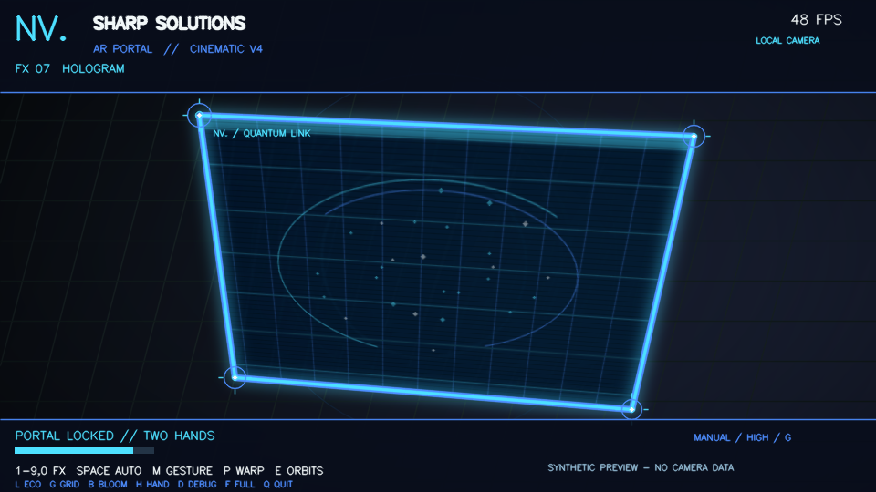

# NV. AR PORTAL V4 — CINEMATIC UPGRADE


*NV. AR Portal V4 — AI-powered hand tracking
and cinematic holographic effects.
Synthetic preview, not a live camera capture.*

### Developer & Creator

**Navod Ravindu Jayaweera**

Founder & Developer — NV SHARP SOLUTIONS

Project: NV. AR Portal V4 — Cinematic Edition

**NV SHARP SOLUTIONS** · An original, privacy-conscious Python computer-vision demo built **from the working V3 codebase**, without changing V3.

This is a **2.5D screen-space illusion**, **not** real 3D spatial tracking. As two open hands move in front of a webcam, MediaPipe supplies 2D hand landmarks, OpenCV constructs a four-corner polygon between thumb/index pairs and maps a stylized live image into it.

## What's new in V4

- **One-hand gesture control:** show **only one hand**, pinch thumb + index together and **hold ~0.7 seconds** to advance to the next effect. Fully release before another gesture. The action disables automatic cycling. A small HUD ring displays progress. Gestures are **off/on** using `M` and do **not** trigger while two hands are tracked.
- **10 visual effects:** RGB Glitch, Neon Edges, Thermal, Negative, Ink Sketch, Pixel Shift, Hologram, Data Ghost, Aurora Field and Spectral Split.
- **Reactive "energy" field:** portal animation intensity follows the distance between the hands (stylized, not a real electromagnetic measurement).
- **Orbital particles, curved light traces, trailing anchors:** rendered inside and just outside the holographic perspective surface.
- **One Euro adaptive smoothing** for softer jitter without the sluggish fixed low-pass look.
- **HIGH / ECO** (`L`) quality toggle. ECO reduces portal texture processing from **480x270** to **320x180**; it does not change webcam or screen resolution.
- **Debug hand landmarks** (`D`), enabled on demand. All existing V3 controls are retained and the application remains local-first.

## Setup (Windows / VS Code)

### Step 1 — Extract

Download and extract `NV_AR_Portal_V4.zip` directly **into `D:\Programming`** (the ZIP already contains a folder named `NV_AR_Portal_V4`). The recommended result:

```text
D:\Programming\
    NV_AR_Portal_Starter\
        .venv\Scripts\python.exe    # Python 3.11 environment that worked with V3
    NV_AR_Portal_V3\                # your existing V3; LEAVE UNCHANGED
    NV_AR_Portal_V4\
        main.py
        cinematic.py
        interaction.py
        download_model.py
        requirements.txt
        models\
        tests\
```

**Important:** Because Windows extraction can create nested folders, find and open the **specific folder that contains `main.py`**. In VS Code: **File → Open Folder**, then **Terminal → New Terminal**. The terminal must show the location of V4's `main.py`.

### Step 2 — Reuse the hand model from the working V3

The V3 project on your PC might itself have an extra nested folder. The following commands locate the model recursively (they **only copy the model file**, they never modify V3):

```powershell
$model = Get-ChildItem "D:\Programming\NV_AR_Portal_V3" -Recurse -File -Filter "hand_landmarker.task" | Select-Object -First 1
if ($model) { Copy-Item $model.FullName ".\models\hand_landmarker.task" }
Test-Path ".\models\hand_landmarker.task"
```

Expected last line: `True`. If it displays `False`, you can explicitly download the **official fixed MediaPipe model** using:

```powershell
& "D:\Programming\NV_AR_Portal_Starter\.venv\Scripts\python.exe" .\download_model.py
```

`download_model.py` is separate from the camera application and uses an HTTPS model URL, a size limit and a temporary file. **The downloader does not verify a pinned vendor SHA-256**; for production releases, check and pin the vendor-provided digest first. You may alternatively copy `hand_landmarker.task` directly from your V3 `models` folder.

### Step 3 — Run V4 (reuse your V3-tested Python environment)

```powershell
& "D:\Programming\NV_AR_Portal_Starter\.venv\Scripts\python.exe" .\main.py
```

You do **not** need to uninstall Python 3.15 or make a second `.venv`. Your previously working Python 3.11 V1 environment can run V4 with the same installed libraries. If it was removed, create a new Python 3.11 virtual environment and install `requirements.txt`.

Place two hands in the webcam view with thumbs and index fingers separated; adjust lighting and keep a visible gap. If the portal is missing, try spreading hands farther apart. **Keep keyboard focus on the camera window, not VS Code Terminal.**

## V4 controls

| Key / action | Result |
|---|---|
| One hand: thumb-index pinch and hold about 0.7s | Next effect; release before next |
| `1`–`9` and `0` | Choose effects 1 through 10 |
| `Space` | Automatic effects on / off (starts OFF) |
| `M` | Pinch gesture controls on / off |
| `P` | Perspective distortion on / off |
| `E` | Animated orbital energy on / off |
| `L` | HIGH / ECO quality |
| `G` | Hologram grid on / off |
| `B` | Bloom glow on / off |
| `S` | Scanlines on / off |
| `H` | Approximate hands-in-front compositing on / off |
| `C` | Cinematic vignette on / off |
| `D` | Debug hand landmarks on / off |
| `Tab` | Show / hide help text |
| `F` | Toggle fullscreen (if OpenCV window backend supports it) |
| `Q` or `Esc` | Exit and release camera |

**Why can't I pinch while holding the portal?** The portal is designed for two **open** hands; the effect-switch gesture requires **one** hand specifically to avoid accidental triggers and avoid interfering with the four-corner shape.

## Quick offline tests

Synthetic tests do not access camera, model, network or personal images:

```powershell
& "D:\Programming\NV_AR_Portal_Starter\.venv\Scripts\python.exe" -m unittest discover -s tests -v
```

`preview_synthetic.png` is **generated from synthetic pixels** to show the approximate V4 design, **not a real webcam screenshot** or a live-performance benchmark.

## Troubleshooting

- `No module named mediapipe` / `cv2` — use the **same .venv as V3** or install the pinned-range dependencies from `requirements.txt` into a Python 3.11 `.venv`.
- Model missing — `Test-Path ".\models\hand_landmarker.task"`; ensure your PowerShell terminal is inside the folder containing V4 `main.py`.
- Webcam fails to open — close other camera apps, check **Windows Settings → Privacy & security → Camera**. As an advanced option, try `CAMERA_INDEX = 1` at top of `main.py` if you have multiple webcams.
- Flickering geometry — use two hands with thumbs/index separated, avoid overlapping hands, improve lighting. A deliberate brief dropout grace of 2 frames and adaptive smoothing help, but cannot fix low-quality detections.
- Low FPS — press `L` to enable ECO; disable `E` orbitals, `B` bloom or `G` grid. If needed, adjust `CAMERA_WIDTH, CAMERA_HEIGHT = 640, 480` at top of `main.py`.
- Gesture not detected — use **one hand** and hold a clearly closed thumb/index pinch **for ~0.7 seconds**, then fully release; ensure `M` is on. The ratio thresholds are simple heuristics, not a calibrated gesture classifier.
- MediaPipe `feedback_manager` messages — some are diagnostic warnings; success requires checking the **actual camera window**. If it exits, send the terminal error and a screenshot.

## Safety, privacy and implementation limits

- Python `main.py`, `interaction.py` and `cinematic.py` perform **in-memory local frame operations**. This application implements **no saved photos, recordings, audio capture, remote inference, accounts, identity recognition, or upload of camera frames**. It uses a few-frame position trail held only in RAM. Dependencies' internal logging/network behavior was **not independently audited**; no unsupported promise of complete privacy is made.
- This V4 has no screenshots/recording controls by design. For a public demo/video, obtain permission from anyone in camera view. Enable camera access knowingly and exit with `Q`.
- Hand occlusion relies on approximate line/convex-hull geometry, **not accurate segmentation**; V4 isn't a full AR/VR engine.
- Tests cover offline graphics, interaction and data validity, **not real webcam reliability, OS compatibility, frame rate, or comprehensive security**. Live test the V4 on Windows before publishing or relying on it.
- No client assets, paid services, arbitrary scripts, secret keys or remote telemetry were included in the code supplied here.

Official docs: [MediaPipe Hand Landmarker Python](https://ai.google.dev/edge/mediapipe/solutions/vision/hand_landmarker/python) · [OpenCV warpPerspective](https://docs.opencv.org/4.x/da/d54/group__imgproc__transform.html).

**Brand:** Always render `NV.` with the period, and preserve **NV SHARP SOLUTIONS** navy `#080d1b`, blue `#4d8dff`, and cyan `#4de0ff`.
